# HostelHub – Smart Hostel Management System

HostelHub is a full-stack web application that helps a hostel manage rooms, fees, complaints and visitors. It has two portals: one for the **admin** and one for **students**.

## Screenshots

| Home | Register | Login |
|---|---|---|
| 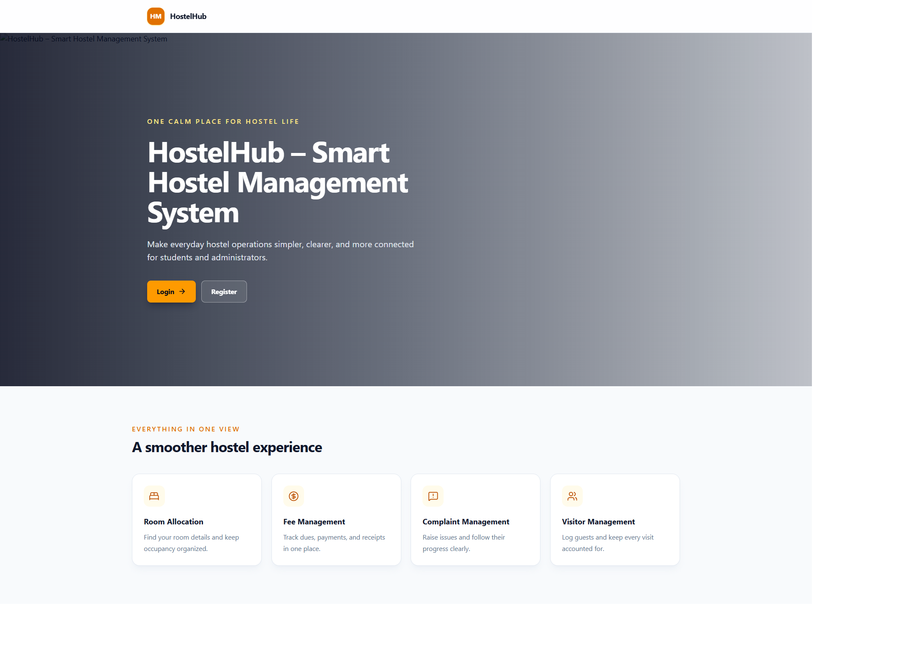 | 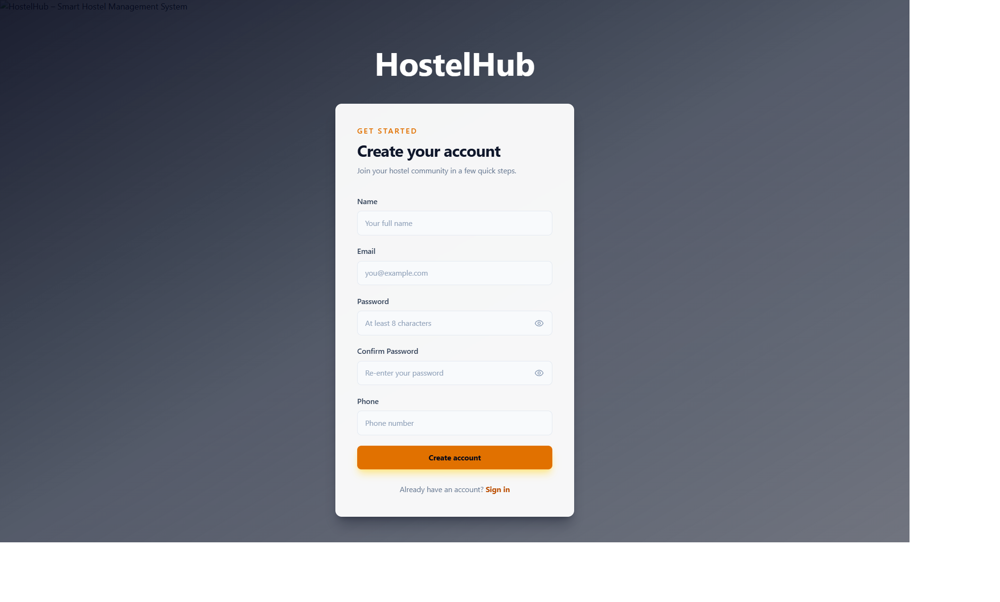 | 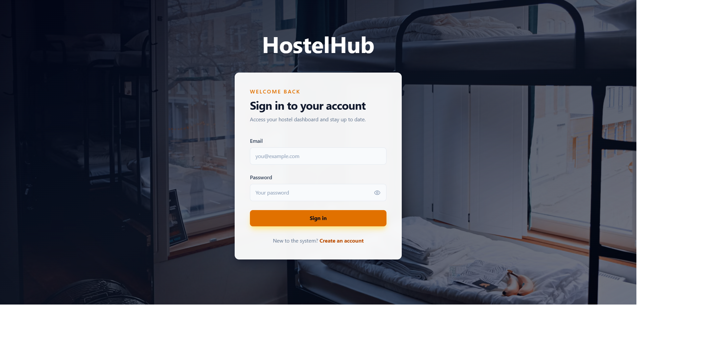 |

### Admin portal

| Dashboard | Rooms |
|---|---|
| 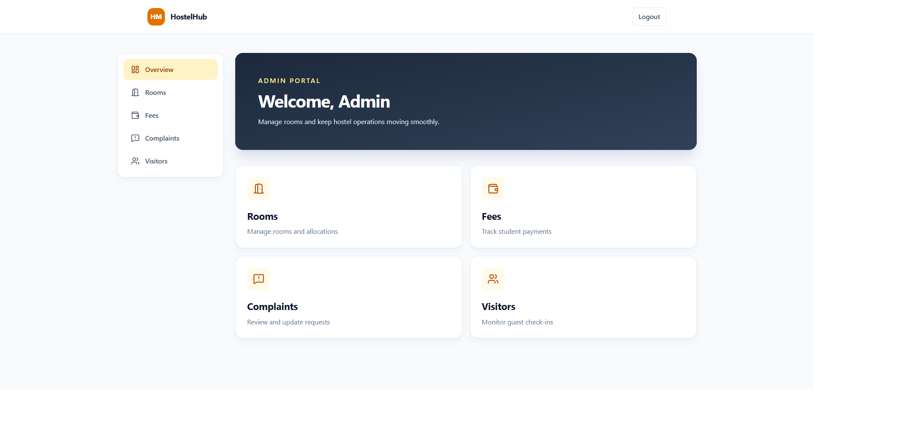 | 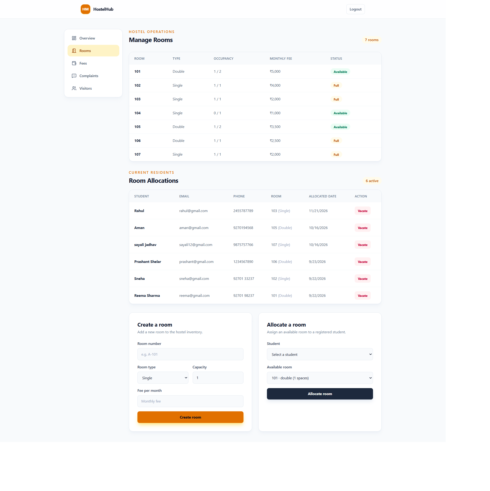 |

| Fees | Complaints | Visitors |
|---|---|---|
| 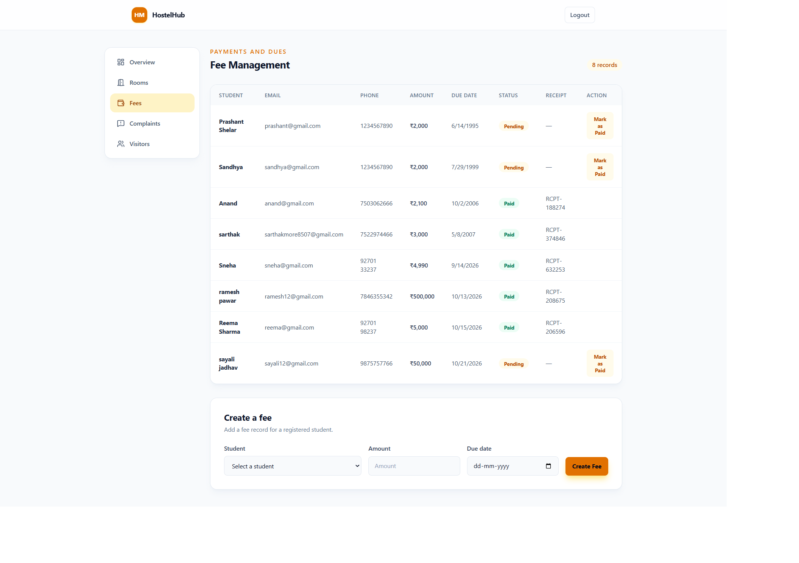 | 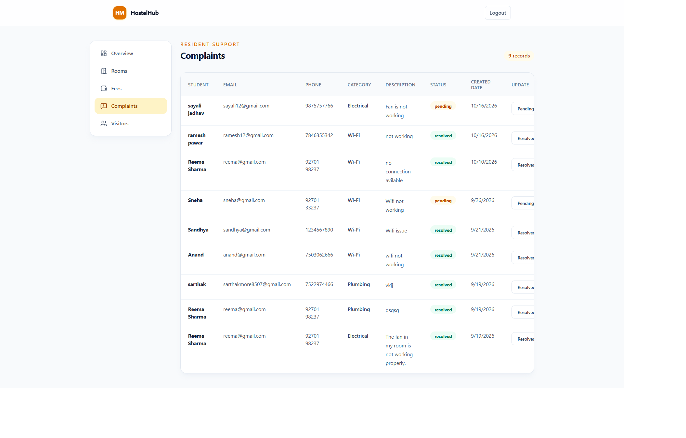 | 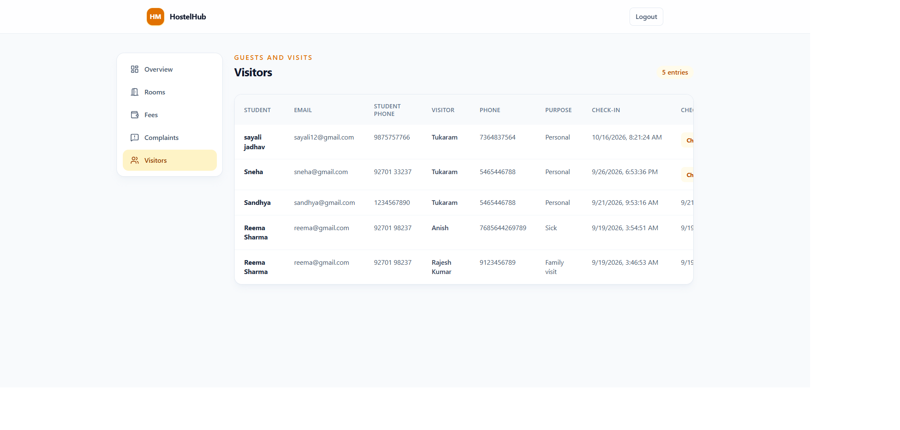 |

### Student portal

| Dashboard | My Room | My Fees |
|---|---|---|
| 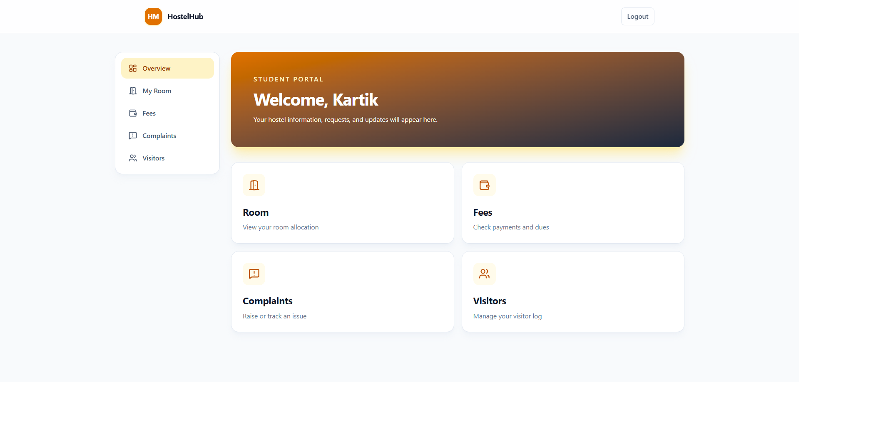 | 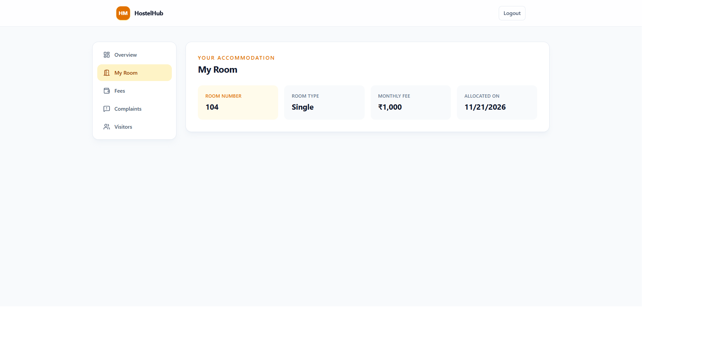 | 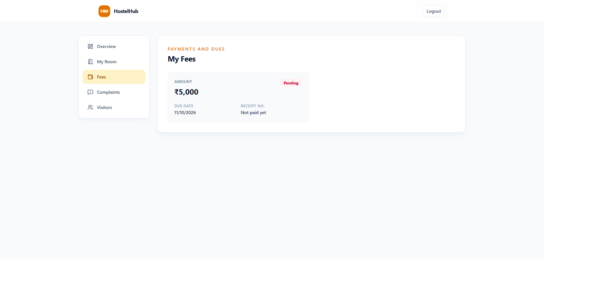 |

| My Complaints | My Visitors |
|---|---|
| 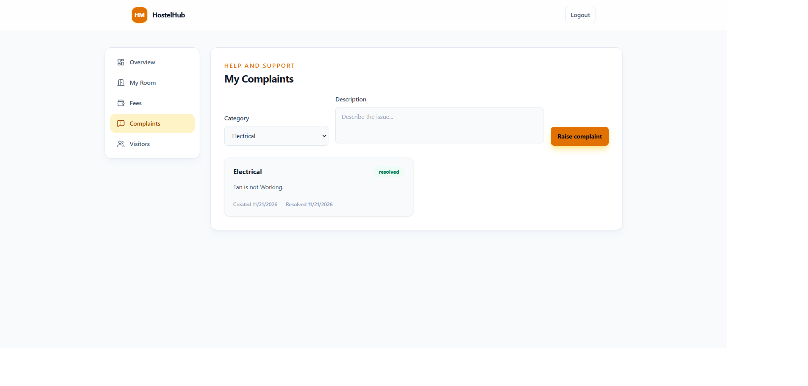 | 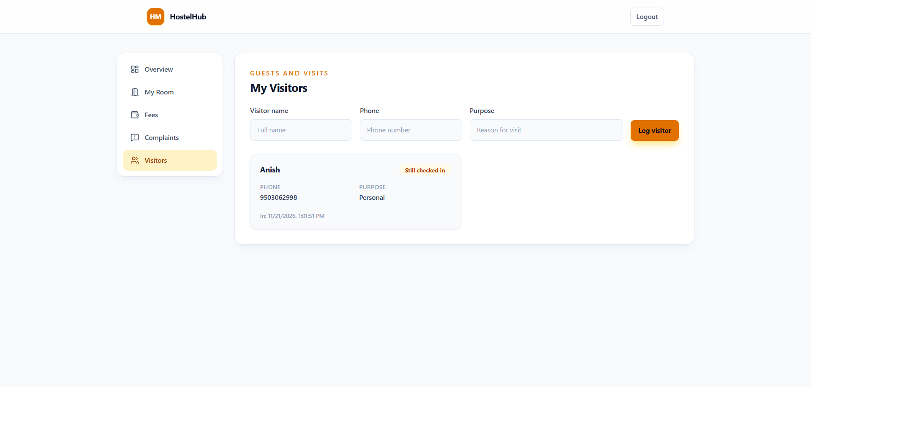 |

## Features

**Students**
- Register and log in with form validation (strong password rules and a valid 10-digit phone number)
- View their allocated room
- Check fees and dues
- Raise and track complaints
- Manage their visitor log

**Admin**
- Create rooms and allocate or vacate rooms for students
- Create fee records and mark fees as paid
- View complaints and update their status (pending, in-progress, resolved)
- View the visitor log and check visitors out
- See each student's phone number alongside their records

## Tech Stack

| Part | Technology |
|---|---|
| Frontend | React (Vite), React Router, Axios, Tailwind CSS |
| Backend | Python, FastAPI |
| Database | MongoDB Atlas (via Motor) |
| Security | JWT login tokens, bcrypt password hashing, role-based access (admin and student) |

## Project Structure

```
HostelHub/
├── client/        React frontend (pages, components, API setup)
├── server/        FastAPI backend (server/app)
├── screenshots/   Images used in this README
└── LICENSE
```

## How to Run Locally

You need Python, Node.js and a free MongoDB Atlas cluster.

**1. Backend**
```
python -m venv venv
venv\Scripts\activate
pip install -r server\requirements.txt
cd server
python -m uvicorn app.main:app --reload
```
The backend runs at http://127.0.0.1:8000, and the API docs are at http://127.0.0.1:8000/docs.

Create a `.env` file inside the `server` folder with your own MongoDB Atlas connection string and secret key. This file is private and is not included in this repository.

**2. Frontend**
```
cd client
npm install
npm run dev
```
The frontend runs at http://localhost:5173.

## Roles

- The Register page creates **student** accounts.
- The admin account is created directly in the database.

## License

All rights reserved. See the [LICENSE](LICENSE) file. This project is shared for viewing and evaluation only.
## Authors

- Siddhi More, BBA Computer Applications (third year)
- Prajakta Ganage, BBA Computer Applications (third year)